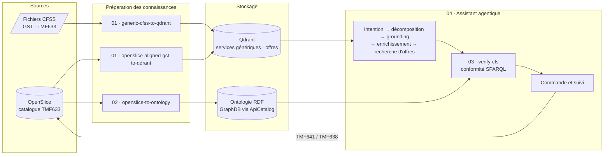

# De la demande en langage naturel au déploiement d'une slice 5G

**Assistant multi-agents construit avec n8n et des LLM locaux.** Un client décrit son besoin en langage naturel (« couvrir un stade : capteurs, vidéo, sécurité »). L'assistant le décompose en capacités 5G, trouve les offres dans le catalogue **OpenSlice (TMF633)**, vérifie leur conformité dans une **ontologie RDF**, puis passe et suit la commande (**TMF641 / TMF638**).

> Conçu et développé à Télécom SudParis (2025–2026), dans le cadre du projet **NF-MUST** du PEPR « Réseaux du futur ».

## Architecture



## Les workflows

| # | Workflow | Rôle |
|---|---|---|
| 01 | [`generic-cfss-to-qdrant`](workflows/01-ingestion/generic-cfss-to-qdrant.json) | Indexe un type de service générique : digest, résumé par un LLM local, embedding, puis Qdrant |
| 01 | [`openslice-aligned-gst-to-qdrant`](workflows/01-ingestion/openslice-aligned-gst-to-qdrant.json) | Indexe les offres OpenSlice alignées **GSMA GST**, avec environ 40 attributs en métadonnées filtrables |
| 02 | [`openslice-to-ontology`](workflows/02-sync/openslice-to-ontology.json) | Synchronise le catalogue OpenSlice vers l'ontologie (CFS / RFS, création idempotente) |
| 03 | [`verify-cfs`](workflows/03-subworkflows/verify-cfs.json) | Sous-workflow : vérifie par SPARQL qu'une offre respecte les exigences du client. Verdict `PASS` / `PASS_WITH_GAPS` / `FAIL` |
| 04 | [`agentic-slice-assistant`](workflows/04-assistant/agentic-slice-assistant.json) | Assistant de bout en bout (62 nœuds) : de la demande à la commande et au suivi |

## Points clés

- **Agents à responsabilité unique**, avec une validation de contrat JSON entre chaque étape.
- **RAG sur plusieurs collections Qdrant**. Les specs sont résumées par un LLM avant l'embedding, pour un meilleur matching.
- **Vérification de conformité par ontologie** : un verdict sur trois niveaux, sans faux positif sur un KPI non documenté.
- **Idempotence et état conversationnel** : une demande peut compléter la proposition en cours, et aucune commande n'est créée en double.
- **100 % local** : LLM et embeddings servis par Ollama (Qwen).

Pour aller plus loin : [choix techniques](docs/design-choices.md) · [détail des workflows](docs/workflows.md) · [contrat de verify-cfs](docs/verify-cfs.md)

## Stack

n8n · JavaScript · Ollama (Qwen) · Qdrant · GraphDB / SPARQL · OpenSlice · Keycloak · TM Forum (TMF633, TMF641, TMF638) · GSMA GST (NG.116)

L'API de l'ontologie est dans un dépôt séparé : **[ApiCatalog](https://github.com/bendoumahosni/ApiCatalog)**. C'est un backend FastAPI qui convertit le JSON TMF633 en RDF, le valide avec SHACL et le stocke dans GraphDB.

## Démarrage

Prérequis : n8n, Qdrant, Ollama (`qwen3.5:4b`, `qwen3.6:35b`, `qwen3-embedding`), OpenSlice et [ApiCatalog](https://github.com/bendoumahosni/ApiCatalog).

```bash
cp .env.example .env          # renseigner adresses et identifiants
python3 scripts/configure.py  # génère les workflows configurés dans build/ (ignoré par Git)
```

Dans n8n :
1. Importer `build/` dans l'ordre **03 → 01 → 02 → 04**.
2. Recréer les *credentials* Qdrant et Ollama.
3. Dans l'assistant, resélectionner le sous-workflow `verify-cfs` (nœud `CFS Verification`).

Les exports publiés ici ne contiennent ni adresse interne ni mot de passe : ces valeurs sont réinjectées à partir de `.env`.

## Auteur

**Hosni Ben Douma** : conception et développement de l'ensemble des workflows et de l'API de l'ontologie.
[GitHub](https://github.com/bendoumahosni) · [LinkedIn](https://www.linkedin.com/in/hosni-ben-douma)
