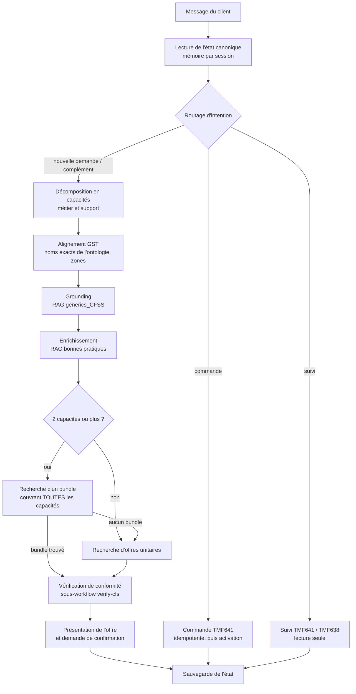

# Détail des workflows

## 01 · `generic-cfss-to-qdrant` : indexation d'un type de service générique

Alimente la collection Qdrant **`generics_CFSS`**. L'agent de *grounding* de l'assistant l'interroge pour rattacher une capacité métier (par exemple URLLC ou mMTC) à son service générique.

| Étape | Nœud | Rôle |
|---|---|---|
| 1 | Form Trigger | Upload d'un fichier JSON CFSS (format GST / TMF633) |
| 2 | Extraction & Digest | Réduit chaque `serviceSpecCharacteristic` à une ligne : `nom [type] {tags} : valeurs`. Les plages sont gardées avec leur unité. Le digest est limité à 400 lignes |
| 3 | LLM Résumé (Ollama) | `qwen3.5:4b`, température 0,2 : résumé factuel de 4 à 6 phrases (usage, garanties chiffrées, profil de trafic). Le prompt interdit d'inventer ou de citer un autre service |
| 3b | Extraire Résumé | Retire les éventuelles balises `<think>` et échoue explicitement si le résumé est vide |
| 4 | Embedding (Ollama) | `qwen3-embedding` sur `nom + description + résumé` |
| 5 | Construction Payload | Point au format `{ pageContent, metadata }` attendu par le nœud Qdrant LangChain de n8n. Id numérique dérivé de l'id de la spec |
| 5b | Vérifier / Créer Collection | Crée `generics_CFSS` si elle n'existe pas (distance cosinus, taille déduite du vecteur) |
| 6 | Upsert Qdrant | `PUT /collections/generics_CFSS/points?wait=true` |

## 01 · `openslice-aligned-gst-to-qdrant` : catalogue d'offres aligné GST

Reconstruit la collection **`Aligned_GST_Service_Catalog`**. Les agents de recherche d'offres (bundle et unitaires) l'interrogent.

| Étape | Nœud | Rôle |
|---|---|---|
| 1 | Form Trigger | Lancement manuel de la synchronisation |
| 2 | Delete Collection | Vide la collection (reconstruction complète, sans doublon) |
| 3 | Token + catalogue | Authentification Keycloak, puis `GET serviceSpecification?limit=1000` (TMF633) |
| 4 | Filter aligned CFS | Garde les **CFS** modifiés depuis une date de référence, écarte les specs de test et ne conserve que la version la plus récente de chaque nom |
| 5 | getServiceSpecById | Récupère la spec complète, car la liste ne contient pas les caractéristiques |
| 6 | Clean CFS (GST attributes) | Construit le texte à vectoriser et extrait environ 40 attributs **GSMA GST NG.116** (disponibilité, isolation, zone, débits, 5QI, latence UPF, mobilité…). Ajoute le niveau d'offre (Basic / Premium / Gold), `isBundle` et les RFS de réalisation. Les attributs inconnus sont listés dans `unmapped_characteristics` |
| 7 | RAG Catalog (ingestion) | Data Loader + découpage + embeddings Ollama, puis insertion dans Qdrant avec les métadonnées filtrables |

## 02 · `openslice-to-ontology` : synchronisation du catalogue vers l'ontologie

Alimente l'**ontologie RDF** (GraphDB) via son API. Le sous-workflow `verify-cfs` interroge ensuite cette ontologie.

| Étape | Nœud | Rôle |
|---|---|---|
| 1 | Form Trigger | Lancement manuel |
| 2 | Token + catalogue | Authentification, puis liste des `serviceSpecification` |
| 3 | Clean Service Specs | Aplatit la réponse et produit un item par spec (`id`, `name`, `kind`) |
| 4 | Get Full Spec | Spec complète par id |
| 5 | Set @type | Supprime récursivement les `uuid` et les valeurs `null`, refusés par le contrat de l'API. Fixe `@type` (CFS ou RFS) par une heuristique : `@type`, nom, catégories, relations |
| 6 | Switch | Oriente vers `/concret-cfs` ou `/concret-rfs` |
| 7 | Vérifier résultats CFS | `2xx` = créé, `409 entity_already_exists` = ignoré. Toute autre réponse est collectée puis remontée en **une seule erreur** récapitulative (créés / ignorés / erreurs) |

## 03 · `verify-cfs` : vérification de conformité

Sous-workflow appelé par l'assistant pour chaque capacité. Voir [`verify-cfs.md`](verify-cfs.md).

## 04 · `agentic-slice-assistant` : l'assistant de bout en bout

Assistant conversationnel de **62 nœuds**. Les LLM tournent en local (`qwen3.6:35b` via Ollama). Il répond dans la langue de l'utilisateur (français ou anglais).

**Principes de conception**
- **Un agent, une responsabilité.** Chaque agent traite une seule capacité et ne renvoie que son champ. Le reste de l'objet est reconstruit par du code, ce qui évite qu'un LLM recopie ou altère l'état.
- **Validation entre chaque étape.** Des nœuds `Validate …` et `… Valid?` contrôlent le contrat JSON. En cas d'échec, une réponse d'erreur explicite est renvoyée à l'utilisateur au lieu de continuer avec des données fausses.
- **État canonique et compléments.** Le portefeuille de capacités est stocké par session. Un complément applique des opérations `add / update / remove` déterministes sur l'état courant, au lieu de relancer toute la chaîne.
- **Idempotence.** Une capacité inchangée réutilise son service générique et son offre sans rappeler le RAG. Côté commande, l'agent vérifie d'abord l'existence d'une commande TMF641 pour les mêmes CFS avant d'en créer une.
- **Activation automatique.** OpenSlice crée les commandes à l'état `INITIAL`. Le workflow les passe à `ACKNOWLEDGED` pour lancer l'orchestration.
- **Suivi factuel.** L'agent de suivi distingue l'état de la commande (TMF641) de celui de l'instance de service (TMF638). Il ne conclut jamais qu'un service est actif sur la seule base d'une commande terminée.
